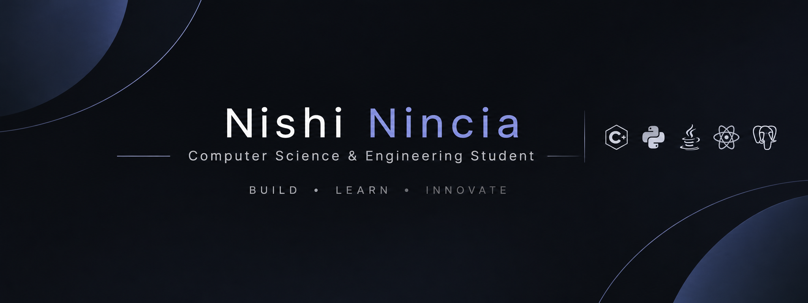

  

### Computer Science Undergraduate | AI/ML | Software Development

I'm a Computer Science undergraduate interested in building
practical AI systems and software applications.

- 🔭 Working on applied AI, computer vision and edge AI projects
- 💻 Interested in Software Engineering, AI/ML and Full-Stack Development
- 🧠 Exploring deep learning, model evaluation and intelligent systems
- 🌱 Continuously improving my problem-solving and development skills

## 🛠️ Technical Skills

**Languages:** Python, C++, Java, SQL

**AI/ML:** PyTorch, TensorFlow/Keras, OpenCV,
NumPy, Pandas, scikit-learn

**Development:** React, Django, Spring Boot,
Node.js, REST APIs, PostgreSQL

**Cloud & Tools:** AWS, Git, GitHub

## 🚀 Featured Projects

### 1. Cross-Modal Skin Imaging
Dermoscopy-to-OCT-like image synthesis using CycleGAN.
Exploring cross-modal medical image translation.

### 2. CareerCrafts
A job search and skill-building platform with
role-based interfaces and REST APIs.

### 3. SecureVitals
An ESP32-based wearable health-monitoring prototype
with sensor integration and fall-detection logic.

### 4. Dog-Cat Classifier
A CNN-based image classification project using
TensorFlow/Keras.

## 🎯 Areas of Interest

- Software Engineering
- Artificial Intelligence and Machine Learning
- Computer Vision
- Full-Stack Development
- Edge AI and IoT

## 📫 Connect with me

- GitHub: https://github.com/NishiNincia
- LinkedIn: https://www.linkedin.com/in/nishi-nincia/
- Kaggle: 
